# Architecture

PhotoCleaner is a .NET 10 console application that processes media files in preparation for import into photo management systems (Lightroom, Immich, PhotoPrism). It analyzes and transforms media files through validation, modification, and verification phases.

## Project Structure

- **Docker/**: Docker configuration
  - `Dockerfile`: Two-stage build (SDK Alpine build -> runtime Alpine final) that installs `exiftool` and `ffmpeg` in the final stage
- **PhotoCleaner/**: Main console application
  - `Program.cs`: Entry point with logger setup (Main only)
  - `CommandLine.cs`: System.CommandLine implementation for CLI parsing (`process`, `undo`, `import`, `index`, `trash`, and `verify` subcommands)
  - `MediaUtilities.cs`: Shared static utilities, `SupportedExtensions` (FrozenSet), `GetUniqueFileName`, `GetExifToolJsonAsync`, `TrySetCreateDateAsync`, `WriteExifToolAsync`, video/duration constants
  - `CommandRunner.cs`: Thin wrapper for command start/complete/error logging, taking `Func<Task<int>>` and returning the command's exit code
  - `ExitCode.cs`: The shared exit-code contract, being `Success` (0), `Error` (1, command could not run), and `Failed` (2, ran to completion with per-file failures)
  - `DatabaseScope.cs`: Generic async DB lifecycle helper (create, init, dispose)
  - `TrashDatabaseScope.cs`: Same lifecycle helper pattern for `TrashDatabase`
  - `FileEnumerator.cs`: Parallel file enumeration returning `(IReadOnlyList<string>, int)`
  - `DirectoryCleaner.cs`: Static helper that deletes empty subdirectories under a root (deepest-first, and the root itself is never deleted), used by `import` and `process` when `--deleteempty` is set
  - `ProcessCommand.cs`: Process command orchestration, case conflict resolution, reprocessing loop, result reporting
  - `ImportCommand.cs`: Import command orchestration (formerly `OrganizeCommand`)
  - `IndexCommand.cs`: Index command orchestration
  - `TrashCommand.cs`: Trash command orchestration, fetches trashed asset checksums from Immich API, stores SHA-1 hashes in a `TrashDatabase`. With `--processdb` it also stores each asset's image data hash, looked up by SHA-1 in a read-only Process.db
  - `UndoCommand.cs`: Undo command orchestration
  - `VerifyCommand.cs`: Verify command orchestration, which enumerates, runs `VerifyTask`, and reports counts
  - `ProcessTask.cs`: Core file processing pipeline (validation, conversion, metadata)
  - `UndoTask.cs`: Undo logic, reverses recorded conversions and restores `.bak` files
  - `ImportTask.cs`: Import logic, copies (default) or moves supported media files from source into date-based subdirectories under `--outpath`. Inserts a row keyed by SOURCE path into Import.db. Optional SQLite deduplication via `Database`. The opt-in `--imagehash` adds image data hash matching against Import.db and Trash.db. (Formerly `OrganizeTask`.)
  - `VerifyTask.cs`: Verification logic, a decode pass that runs Immich's own `MediaRepository` inside `ghcr.io/immich-app/immich-server:release` via `docker run`, batching paths over stdin. Preflights the image before judging any file, so an infrastructure failure exits `Error` rather than marking files invalid
  - `ImmichVerifyScript.cs`: The Node script run inside the Immich image, as const strings. Calls Immich's own compiled `MediaRepository`, `defaults`, and `ThumbnailConfig` rather than reimplementing the preview pipeline, so behavior tracks Immich across releases
  - `VerifyResult.cs`: The AOT-compatible `ImmichVerifyLine` JSON model and its `ImmichVerifyJsonContext` source-generated context, together forming the container's output protocol
  - `IndexTask.cs`: Common DB upsert logic used by `process` and `index` commands. `IndexFileAsync` (single-file) returns `(IndexStatus, sha256, sha1, wasProcessed)`. `ExecuteAsync` (batch parallel) returns `(inserted, updated, unchanged, ignored, failed)`. When `options.MarkProcessed` is true, newly inserted rows are marked `is_processed=1` (used by `index --processed` to seed Process.db).
  - `Database.cs`: SQLite wrapper with a single `files` table (`path` PRIMARY KEY, `sha256`, `sha1`, `file_size`, `mtime_ticks`, `is_processed`, `content_identifier`, `image_hash`, `metadata_read`). It indexes the hash, `content_identifier` and `image_hash` columns. Size/mtime caching via `ResolveHashesAsync` skips rehashing unchanged files. Every write computes both sha256 and sha1 in a single read pass. Both columns are non-null. A database written before the catalog columns existed is upgraded in place when a writing command opens it.
  - `TrashDatabase.cs`: Simple SQLite wrapper for Immich trash hashes with a single `trash_hashes` table (`sha1` PRIMARY KEY, `original_file_name`, `image_hash`), used by `trash`, `import`, and `process` commands. It indexes `image_hash`. A database written before that column existed gains it in place when `trash` opens it. A read-only open of such a database reports `HasImageHash = false` and matches by SHA-1 only
  - `ImmichApiModels.cs`: AOT-compatible JSON models for Immich API (`ImmichSearchRequest`, `ImmichSearchResponse`, `ImmichAssetDto`) with `ImmichJsonContext` source generation
  - `DateFromPath.cs`: Static utility class for date inference from filenames/paths
  - `ExifToolJson.cs`: JSON model for ExifTool metadata, including the `ExifTool:Validate` verdict and `ParseValidate` which splits it into error and warning counts
  - `SkippedExtensionTracker.cs`: Thread-safe tracker for unknown file extensions skipped during processing; used by all commands that filter by `MediaUtilities.SupportedExtensions` (`process`, `import`, `index`)
  - `LoggerFactory.cs`: Serilog logger factory, reusing an already-configured `Log.Logger` when one exists rather than always creating a new one
  - `Extensions.cs`: Extension methods for logging and error handling
- **PhotoCleanerTests/**: Comprehensive test project (`TempDirectoryFixture.cs` is the shared fixture, not a test class)
  - `DateInferenceTests.cs`: Core date inference functionality tests
  - `CommandLineTests.cs`: Command line parsing and validation tests
  - `ProcessTaskTests.cs`: Process task tests
  - `UndoTaskTests.cs`: Undo task tests
  - `ExifToolJsonTests.cs`: ExifToolJson unit tests (includes GetDate, IsDngVersionNewer)
  - `ImportTaskTests.cs`: Import task tests
  - `DatabaseTests.cs`: Database tests
  - `IndexTaskTests.cs`: IndexTask tests
  - `TrashDatabaseTests.cs`: TrashDatabase tests
  - `TrashCommandTests.cs`: TrashCommand tests with mock HTTP handler
  - `DirectoryCleanerTests.cs`: DirectoryCleaner static helper tests
  - `VerifyTaskTests.cs`: Verify protocol parsing and script-contract tests
  - `LivePhotoCatalogTests.cs`: Live Photo pairing through the catalog and the catalog columns, needs exiftool and ffmpeg
  - `CatalogSchemaTests.cs`: In-place schema upgrade and metadata mapping tests, need no external tools
  - `ArchitectureDiagramTests.cs`: Checks that each `Type.Method()` a Command Logic diagram names exists, and that the suspect marks match the Suspect Branches list

## Core Processing Pipeline

The application uses a sequential validation pipeline where each method returns `bool` -
`false` stops processing the current file:

```csharp
if (!RenameMismatchedMimeExtensions()
    || !RenameMixedCaseExtensions()
    || !await DeleteLivePhotosAsync()
    || !await ConvertVideoAsync()
    || !WarnDngVersion())
```

Before that chain runs, `CheckExifToolValidation` acts on the `ExifTool:Validate` verdict that
rides along with the metadata read. Only an error count fails the file (`ProcessResult.Invalid`).
Warnings are logged at debug level, because roughly three quarters of healthy files in a real
collection carry at least one.

### Two-Phase `process`

When `--db` is given, `ProcessCommand` first catalogs every media file under `--path` in parallel
through `IndexTask`, then runs the per-file pipeline above. The second phase hits the size and
mtime cache, so catalog metadata is read once. Hashes are computed once without `--rehash`. A video is therefore never judged before its still has
been seen. Without `--db` there is no catalog phase and the pipeline runs as before.
A new file costs two exiftool runs, one in the catalog and one in the pipeline, because parsed metadata is not carried across phases.

### Catalog Metadata Columns

`IndexTask.IndexFileAsync` fills `content_identifier` and `image_hash` when it inserts a row or sees new content.
It uses one exiftool run that returns the JSON metadata and the image data hash (`-ImageDataHash -api ImageHashType=SHA256`). `index` and `process` populate
the columns through this path, and `import` fills them from its own metadata read. `verify` indexes without reading metadata, so it needs no exiftool and leaves its rows unread. Other metadata reads leave the hash flag out, since hashing the
image data costs extra I/O.

- `metadata_read` separates "not read yet" from "read, tag absent". Rows from an older database
  start at 0. The next catalog reads them if the file still exists, then sets the flag.
  A row whose file is gone stays unread.
- A null `content_identifier` or `image_hash` with `metadata_read = 1` means the tag is absent,
  which is normal for a format with no image hash.
- ExifTool 12.63 or newer is required, the release that introduced `ImageDataHash`. An older
  version fails the run with a message instead of cataloguing nothing.
- Import dedup and the trash match use the image hash only with the opt-in `--imagehash`. Default runs match by whole-file hash.
- An empty image hash is stored as null and never matches, so a format ExifTool cannot hash keeps whole-file matching.
- A read-only open cannot upgrade a database in the old shape. Only the hash lookups work there.

## Command Logic

The diagrams below trace each command from the command line to the end state of every file. They describe what the code does today, including branches that look wrong, so a reader can compare code and docs branch by branch.

Conventions used in every diagram:

- A label that starts with `Type.Name()` names the method that runs that node. `ArchitectureDiagramTests` checks that each named method exists, so a rename breaks the test until the diagram follows.
- Any other label is prose, and an option name in it refers to a command-line flag.
- A rounded node is an end state: an exit code, or the result a file is counted as. A rounded node that names another diagram continues there.
- A step drawn without a fail edge still throws to the handler the prose under its diagram names.
- A node styled with a dashed red border is a suspect branch. Its `S` number points into [Suspect Branches](#suspect-branches).
- Change a diagram in the same change that moves a branch it draws.

### Run Flow

Program.Main parses the arguments before anything else. A parse error, `--help`, or `--version` skips logger setup and returns the System.CommandLine exit code.

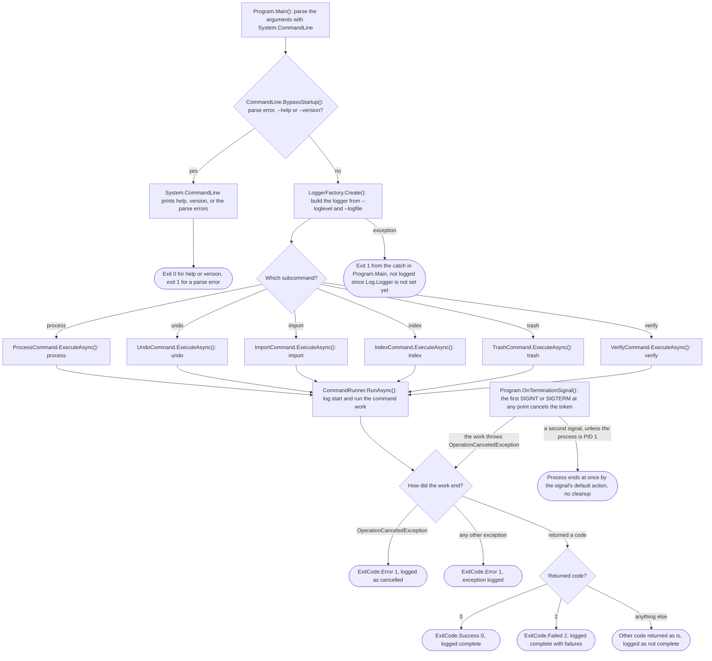

An exception outside CommandRunner.RunAsync, such as one while building the options, reaches the catch in Program.Main and exits 1. Program.Main registers its own SIGINT and SIGTERM handler and sets ProcessTerminationTimeout to null. That keeps System.CommandLine's own handler off. With a timeout set, that handler returns 130 or 143 once it expires, even while the cancel path still runs. The first signal cancels the token the command runs with, so CliWrap kills the child tool and the command's cleanup runs before the exit. A second signal takes the default action and ends the process at once, for a cancel path that hangs. Run as PID 1, as the container image's exec-form entrypoint runs it, the kernel drops that default action. There only a SIGKILL ends a hung cancel path, such as the one `docker kill` sends or the one `docker stop` sends after its timeout.

### Process

#### Process Run

The trash database opens read-only and the process database opens read-write. Both stay open for the whole run. Any exception that escapes this diagram reaches CommandRunner.RunAsync and exits 1.

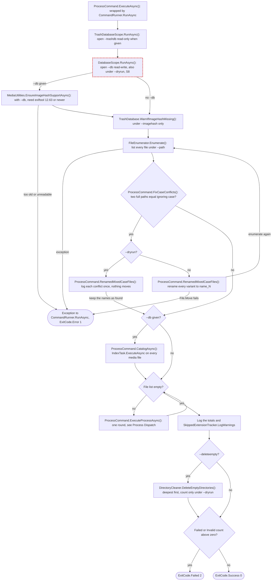

The catalog phase logs a per-file index failure and does not count it. The same file normally fails again in the per-file pipeline, where it is counted. Invalid files fail the run as well as Failed files.

#### Process Dispatch

Each round keeps one media file per directory and stem, so files sharing a stem never run in parallel. Non-media files are never held back.

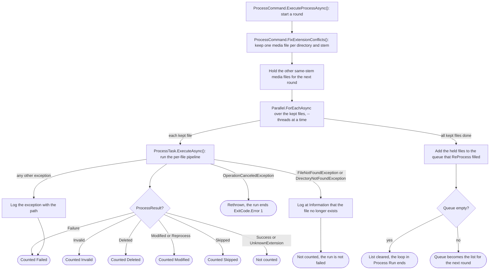

Modified counts each step that queued a new name, not each file. A file renamed and then converted counts twice. Outside a dry run no path returns Modified without also queuing, so Modified results come from Reprocess. A dry run queues nothing, so it counts each file it would change once, by the first step that would change it.

#### Process Per-File Pipeline

The steps run in the order drawn, and the first step returning false stops the chain. Every step throws to the per-file catch in ProcessCommand.ExecuteProcessAsync.

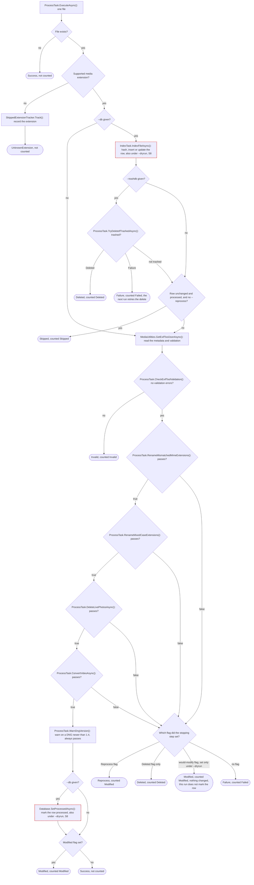

The trash check runs only with `--db`, before the already-processed skip. A file is marked processed only when every step passes. So this run does not mark a deleted or renamed file, a trashed file whose delete failed, or a file a dry run would change.

#### Process Trash Check

The image hash comes from the cataloged row, and only under `--imagehash`. Without it the image hash lookup always answers no.

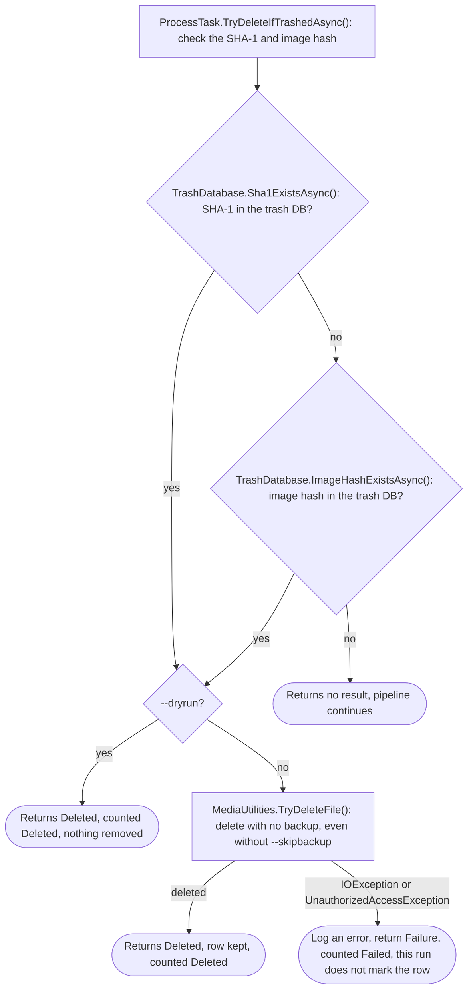

#### Process Renames

RenameMismatchedMimeExtensions runs first, then RenameMixedCaseExtensions. Neither takes a backup, so undo cannot restore the old name. A failed File.Move throws to the per-file catch.

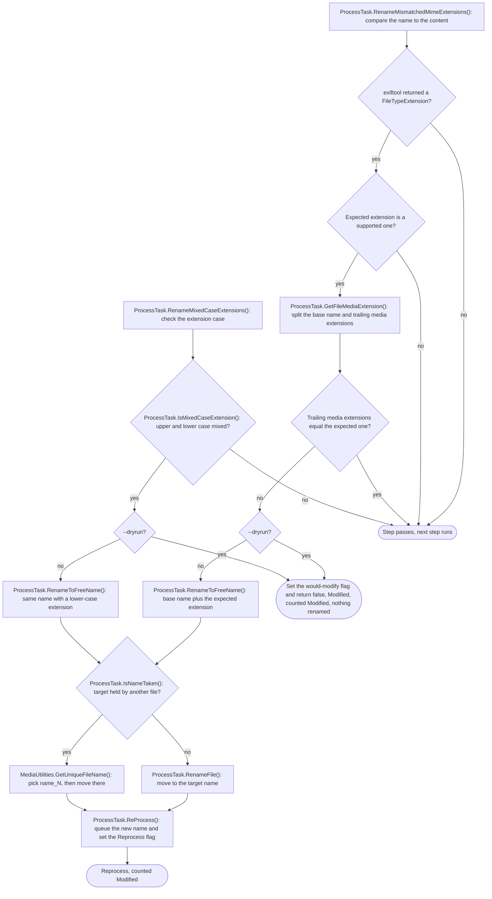

The old path keeps its database row and the new name gets a fresh row in the next round.

#### Process Live Photos

Every file reaches this step, and a file that is not .mov or .mp4 passes it unchanged. A GetDurationAsync output that is not a number throws to the per-file catch.

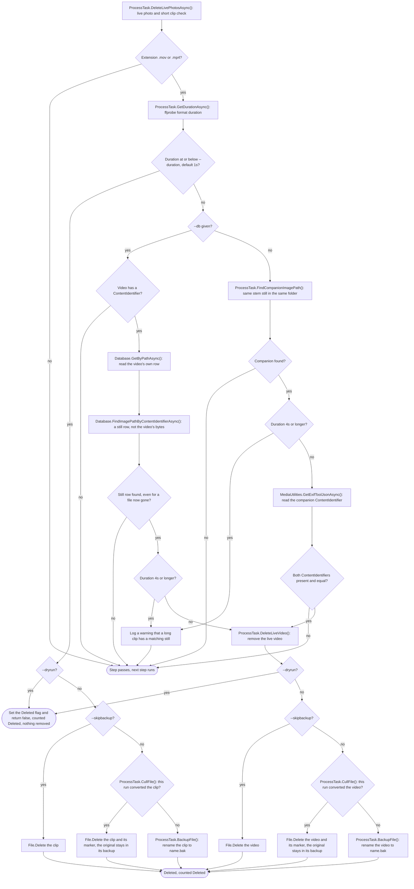

The short clip rule needs no still and runs before any pairing. A deleted video keeps its database row.

#### Process Video Conversion

The temporary output is the source path with its extension changed to .temp. A finally block deletes that file whenever it still exists at the end. A single-frame or short GIF becomes a PNG rather than an MP4. As an MP4 it would meet the short clip rule in Process Live Photos in the next round. A GIF that ffprobe gives no duration, such as a GIF87a still, counts as a still too.

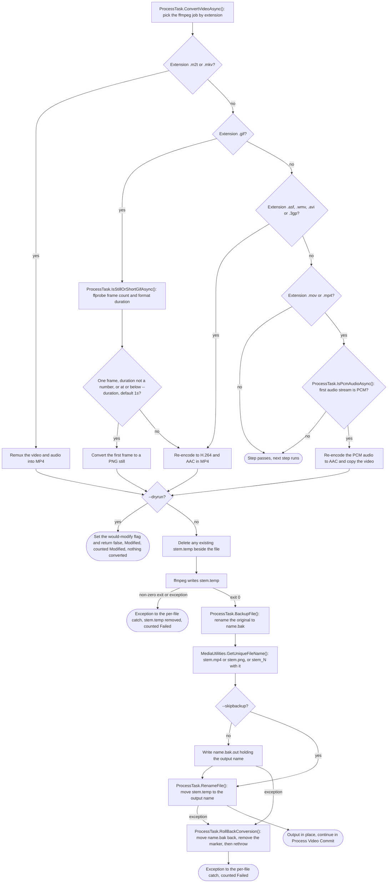

The original is renamed aside in both modes before the output takes a name. Under `--skipbackup` no marker records the pairing. From that rename until the metadata writes land, a failure puts the original back under its own name. An output that cannot be removed leaves both files in place.

#### Process Video Commit

The original is deleted under `--skipbackup` only after both metadata writes land. A failed write rolls the swap back and fails the file.

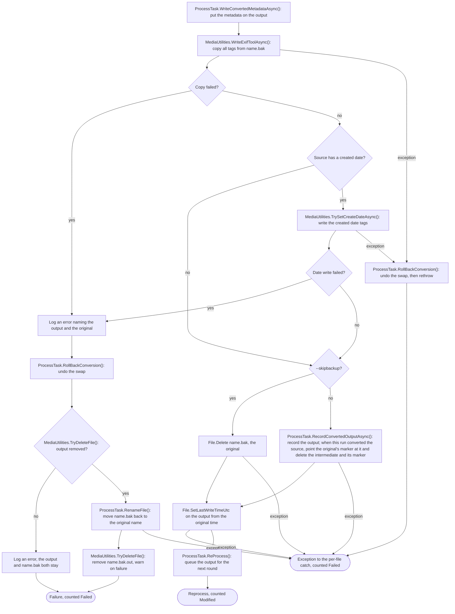

The queued output runs the whole pipeline again in the next round. That includes the short clip rule in Process Live Photos.

### Import

#### Import Run

The command lists every file under `--path` before it opens any database. It then opens `--trashdb`, `--skipdb`, and `--db` in that order, nested, and runs the files in parallel.

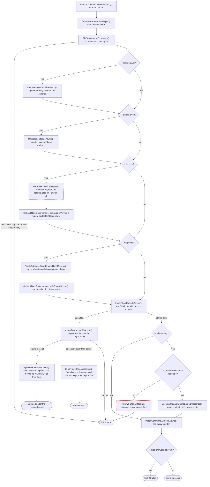

Any exception before `ImportTask.ExecuteAsync()` starts, such as a bad schema or an old exiftool, reaches `CommandRunner.RunAsync()` and exits 1. Ignored, Skipped, SkippedBySkipDb, and TrashedInImmich all leave the exit code at 0.

#### Import Per-File Checks

Each file runs the checks below in this order. The first check that matches decides the result. Exceptions from every step here go to the per-file catch in `ImportTask.ExecuteAsync()`, which counts the file Failed.

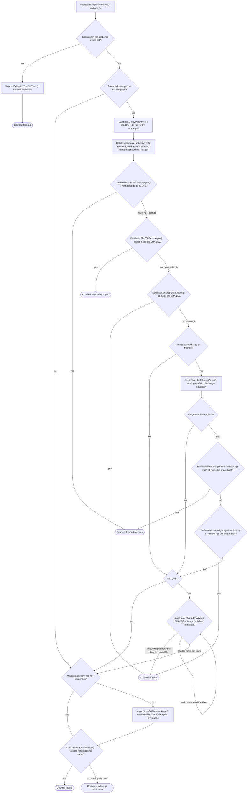

A claim waiter blocks until the owner finishes, then loops if the owner freed the claim. An owner that kept its moved file in `--outpath` holds the claim, though it counts Failed. A file is Skipped by a claim only after it passed every database check.

#### Import Destination

The folder date comes from the inferred path date, else the parsed metadata date, else `DateTime.MinValue`. A dry run ends here, before any file or database write.

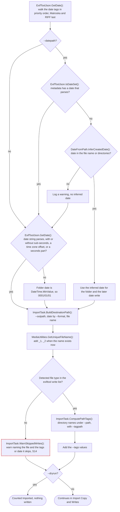

`ExifToolJson.IsDateSet()` is true only when `GetDate()` parses the date, so `--datepath` is tried for a zero or malformed date too. A date with a time zone offset files under the clock time it records, the same reading a date without an offset gets. A `Z` date, as Matroska stores, is that UTC clock time. `GetDate()` takes the first date tag that parses, so a zero date in one tag does not hide a valid one in another. The Matroska date is read from `Matroska:DateTimeOriginal`, with `RIFF:DateTimeOriginal` after it for an AVI.

#### Import Copy and Writes

The created-date write runs before the tag write, and the mtime restore runs after both. The database row describes the source path and its hashes, not the destination.

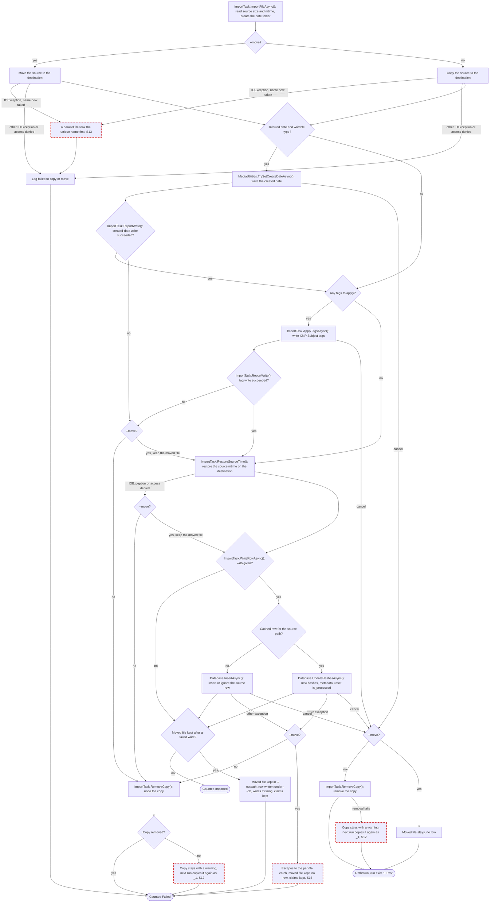

Inside this stage a cancel removes the copy in copy mode and rethrows, even when the copy completed. In copy mode any other failure after the copy also removes the copy, before the file's claims are freed. So a failed write, a failed mtime restore, or a `SqliteException` from the row write leaves the source to import cleanly on the next run. A `SqliteException` still reaches the per-file catch in `ImportTask.ExecuteAsync()`, which counts the file Failed. A copy that cannot be removed stays with a warning instead, S12.

A moved file has no source left to return to, so a failed write keeps it in `--outpath`. It gets the source mtime unless the mtime restore is the write that failed. Its row is still written, keyed by source path and hash as for an import, so a later copy is skipped. The file is counted Failed, and the error names the write that failed. Its claims stay held, so a matching file later in the run is skipped too. Any other exception after a move also keeps the claims, since the moved file is in the library without its row.

### Index

#### Index Run

The index command requires `--db` and opens it read-write. It has no `--dryrun`, and it never removes a row.

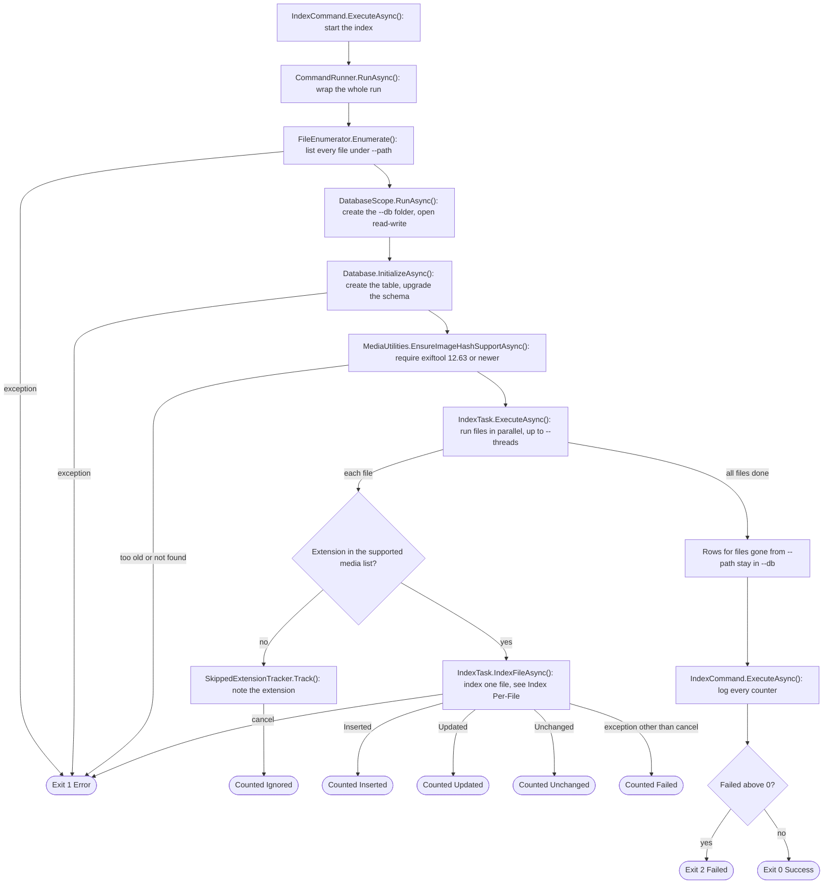

#### Index Per-File

Metadata is read only for a new row, new content, or a row whose metadata was never read. Exceptions from every step here go to the per-file catch in `IndexTask.ExecuteAsync()`, which counts the file Failed. A cancel is rethrown instead, and the run exits 1.

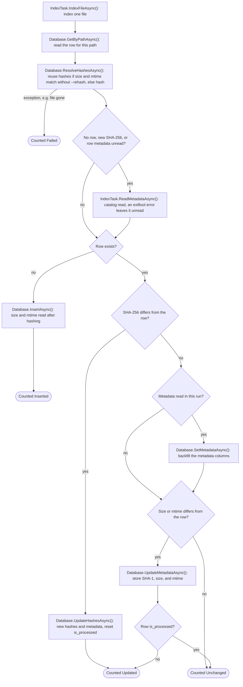

`--processed` sets `is_processed` only on an inserted row. Counted Updated also covers an unprocessed row whose content is the same but whose size or mtime moved.

### Trash

#### Trash Setup and Exit

The trash command opens the trash database read-write and the process database read-only. The sync itself is drawn in the next diagram.

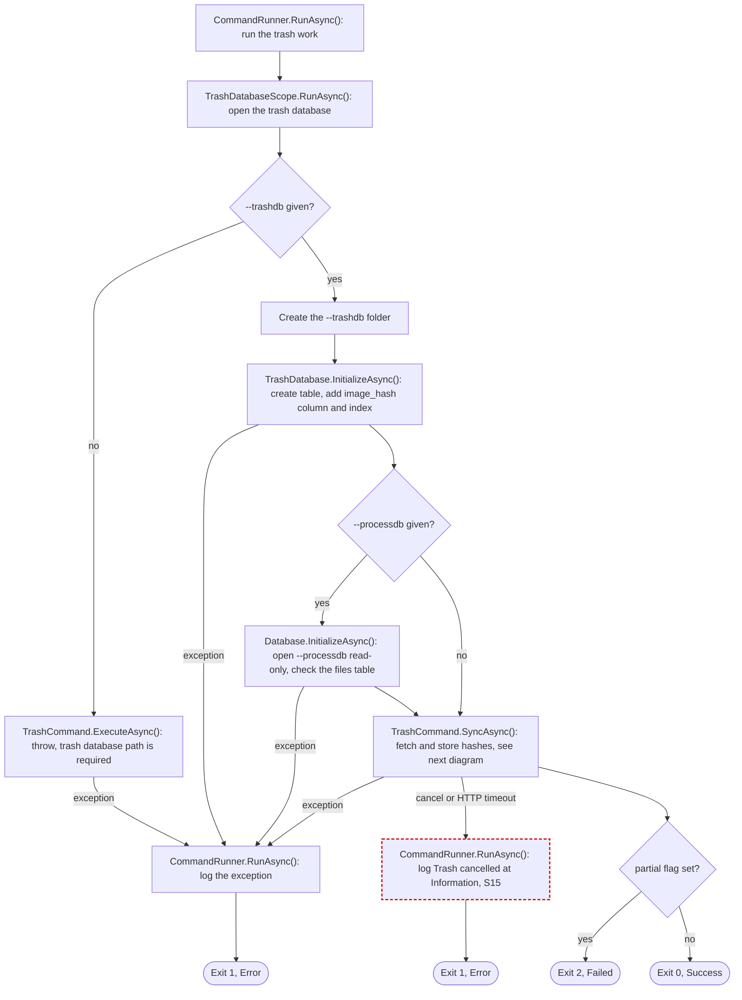

Both databases are disposed in a finally block whichever way the work ends. A required --trashdb makes the missing-path branch unreachable from the command line.

#### Trash Fetch and Store

Each page is committed in its own transaction before the next page is fetched. A page that throws therefore leaves every earlier page stored and skips the image hash backfill.

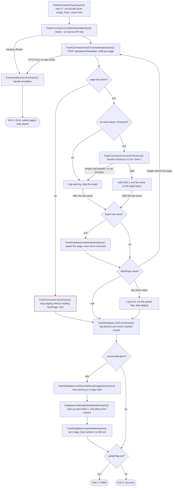

Exceptions from every step, including the count and backfill steps, go to CommandRunner.RunAsync() and exit 1. The upsert keeps an existing file name and only fills an image hash that is still null.

### Undo

#### Undo Inputs

Undo has no database. It reverses only what process left on disk as backup files and .out markers. This diagram shows those states as ProcessTask writes them.

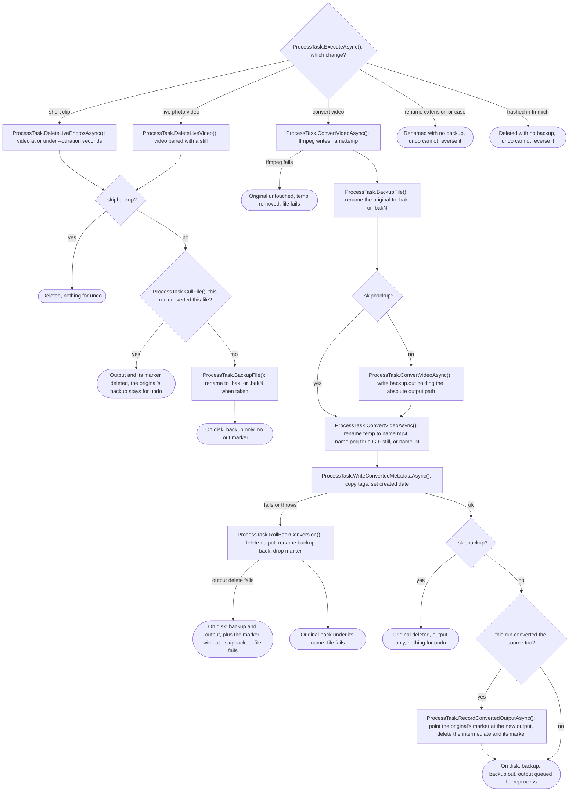

A converted output is reprocessed in the same run, and the run records it. A short clip or live photo video output is then deleted with its marker, since its original already sits in a backup. A second conversion of it leaves one marker on the original. Only the run's own record decides this, never a marker found on disk, which can be stale. Deletion backups never get a marker. A later run, or an older release, backs up such an output instead, since the record lasts one run.

#### Undo Grouping

Undo acts only on what process recorded. It reads every backup of supported media and its .out marker before it changes anything. One backup's marker can name a file another backup holds.

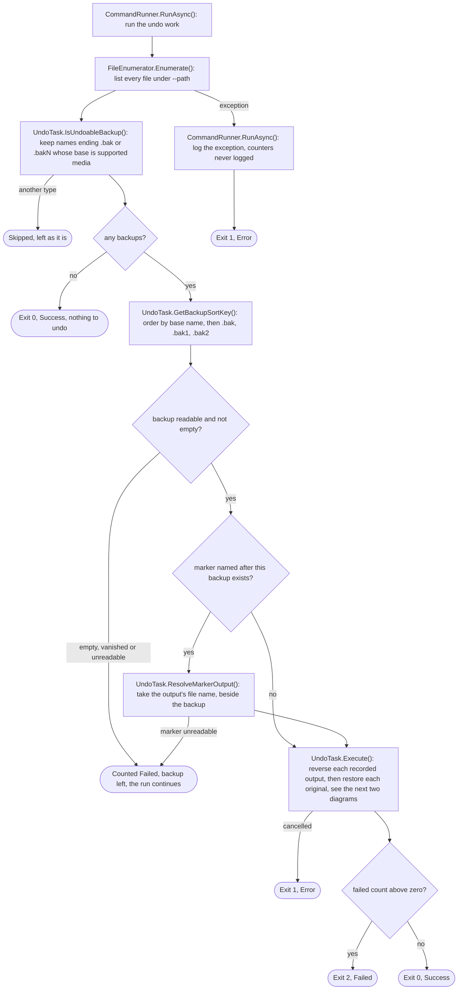

A file or marker error fails only its own backup. Under --dryrun, UndoTask.TryDelete() and UndoTask.TryRestore() change nothing on disk but record the result. A dry run so picks the same free names as a live run, where the volume's case rules match the OS default.

#### Undo Converted Outputs

Each output a marker names is reversed before any original is restored, so an original can take back a name its output held. A backup holding a gone output's name may be that output, culled by a later run or an older release. Undo restores it as an original, which leaves an extra file but never loses one.

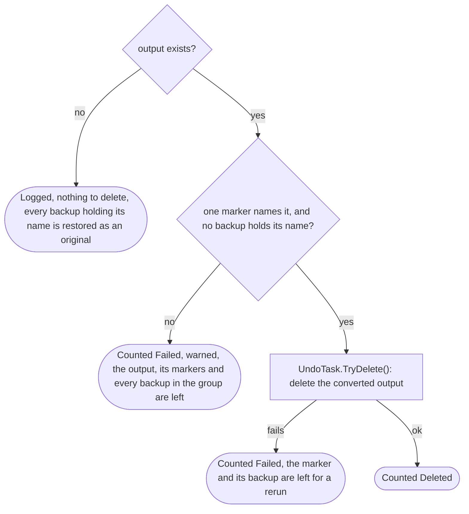

A backup can hold the name of an output that still exists. It may be the output culled by a later run or an older release, or an original backed up before the conversion took its name. Undo cannot tell them apart, so it leaves that group.

#### Undo Restore

Every backup in a group not left above is an original. Undo never deletes a backup, and never overwrites a current file.

```mermaid
flowchart TD
  R1{"its group was left above?"}
  R1 -->|"yes"| R2(["Warned, backup and marker left as they are"])
  R1 -->|"no"| R3["MediaUtilities.GetUniqueFileName(): the base name, or the first name_N no file and no other original's base holds"]
  R3 -->|"name_N"| R4["UndoTask.Execute(): warn, naming the taken file and the free name"]
  R3 --> R5
  R4 --> R5["UndoTask.TryRestore(): move the backup to that name"]
  R5 -->|"IO or access error"| R6(["Counted Failed, backup kept"])
  R5 -->|"ok"| R7{"backup has a marker?"}
  R7 -->|"no"| R8(["Counted Restored"])
  R7 -->|"yes"| R9["UndoTask.TryDelete(): delete the marker"]
  R9 -->|"fails"| R10(["Counted Restored, marker Counted Failed"])
  R9 -->|"ok"| R11(["Counted Restored, marker Counted Deleted"])
```

An output from a release before the .out marker has no record, so it stays beside its restored original.

### Verify

#### Verify Screening

Batches of 1024 files run in parallel, up to --threads at once. A per-file catch turns any screening exception into a Failed count, except cancellation.

```mermaid
flowchart TD
  V1["CommandRunner.RunAsync(): run the verify work"] --> V2["FileEnumerator.Enumerate(): list every file under --path"]
  V2 -->|"exception"| VE
  V2 --> V3["DatabaseScope.RunAsync(): open --db read-write when given, no exiftool check"]
  V3 -->|"exception"| VE
  V3 --> V4["VerifyTask.RunAsync(): chunk into batches of 1024, run --threads at once"]
  V4 --> V5["VerifyTask.ShouldVerifyAsync(): screen each file of the batch"]
  V5 --> V6{"supported media extension?"}
  V6 -->|"no"| V7(["Counted Ignored"])
  V6 -->|"yes"| V8{"file still exists?"}
  V8 -->|"no"| V9(["Counted Failed"])
  V8 -->|"yes"| V10{"--db given?"}
  V10 -->|"yes"| V11["IndexTask.IndexFileAsync(): hash or reuse cache, insert or update the row"]
  V11 -->|"exception"| V9
  V11 --> V12{"row unchanged, is_processed set, no --reprocess?"}
  V12 -->|"yes"| V13(["Counted Skipped, flag shared with process"])
  V12 -->|"no"| V14
  V10 -->|"no"| V14["MediaUtilities.EnsureReadable(): open the file once"]
  V14 -->|"exception"| V9
  V14 --> V15["Add the file to the batch candidates"]
  V15 --> V16{"batch has candidates?"}
  V16 -->|"no"| V20
  V16 -->|"yes"| V17["VerifyTask.PreflightAsync(): once per run, load Immich modules in Docker"]
  V17 -->|"no docker, exit non-zero, or no sentinel"| VE
  V17 --> V18["VerifyTask.DecodeBatchAsync(): decode the batch, see next diagram"]
  V18 -->|"exception"| VE
  V18 --> V20{"after all batches: Invalid or Failed above zero?"}
  V20 -->|"yes"| V21(["Exit 2, Failed"])
  V20 -->|"no"| V22(["Exit 0, Success"])
  VE["CommandRunner.RunAsync(): log the exception, other batches cancelled"] --> V23(["Exit 1, Error"])
  classDef suspect stroke:#c00,stroke-width:2px,stroke-dasharray:5 3
```

The preflight runs only when some batch has a candidate. A tree of non-media or already verified files never needs Docker.

#### Verify Decode Batch

One container judges a whole batch, reading container paths on stdin. Each verdict is matched back to its host file by container path.

```mermaid
flowchart TD
  B1{"path has a line break?"}
  B1 -->|"yes"| B2(["Counted Failed"])
  B1 -->|"no"| B3{"VerifyTask.TryToContainerPath(): path stays under --path?"}
  B3 -->|"no"| B2
  B3 -->|"yes"| B4["VerifyTask.RunImmichAsync(): docker run Immich, read-only bind mount, paths on stdin"]
  B4 -->|"fails to start, not a cancel"| B5(["Every mapped file Counted Failed"])
  B4 --> B6{"Verify script: video extension?"}
  B6 -->|"yes"| B7["Verify script: probe, transcode one preview frame"]
  B6 -->|"no"| B8["Verify script: RAW preview extract best effort, decode a preview"]
  B7 --> B9["Verify script: print one JSON verdict per path"]
  B8 --> B9
  B9 --> B10{"container exit code non-zero?"}
  B10 -->|"yes"| B11["Log the exit code and stderr, keep going"]
  B10 -->|"no"| B12
  B11 --> B12["VerifyTask.ParseLine(): parse stdout lines, key verdicts by container path"]
  B12 --> B13{"verdict returned for this file?"}
  B13 -->|"no"| B2
  B13 -->|"yes"| B14{"verdict ok?"}
  B14 -->|"no"| B15{"host file still exists?"}
  B15 -->|"no"| B2
  B15 -->|"yes"| B16["Log Immich cannot render, also for a symlink leaving the mount"]
  B16 --> B17(["Counted Invalid"])
  B14 -->|"yes"| B18{"--db given?"}
  B18 -->|"yes"| B19["Database.SetProcessedAsync(): set is_processed to 1"]
  B19 -->|"exception"| B20(["Exit 1, Error, the run aborts"])
  B19 --> B21(["Counted Verified"])
  B18 -->|"no"| B21
  classDef suspect stroke:#c00,stroke-width:2px,stroke-dasharray:5 3
```

A verdict the container never printed is a tooling gap and counts Failed, never Invalid. Only Invalid and Failed make the exit code 2.

### Suspect Branches

Each entry describes a branch the diagrams mark, as the code behaves today, and links the issue that tracks its fix. Update the diagram and remove the entry when the fix lands.

- **S8.** A dry run with `--db` creates, upgrades and writes the database, #316.
- **S11.** `import --deleteempty` throws when `--outpath` does not exist, so the run exits 1, #319.
- **S12.** A copy that cannot be removed after a failed import stays with a warning, and the next run imports it again as `_1`, #338.
- **S13.** Two parallel imports with the same name and date can pick the same destination, #321.
- **S14.** For a detected type outside the exiftool write list, `import` skips `--tags`, `--tagpath` and the inferred date with only a warning, #334.
- **S15.** `trash` stops at an empty page without marking the sync partial, and logs a timeout as a cancel, #323.
- **S16.** A moved file whose row write fails stays in `--outpath` with no row, so the next run imports a copy of it again, #340.

## State Management Pattern

- **Primary Constructor Parameters**: Command and task classes use C# 12 primary constructors. All task classes take `CommandLine.Options options` as their first parameter, plus any non-option runtime params (e.g., `Database`, shared collections). Command classes take `(CommandLine.Options options, CancellationToken cancellationToken)` and pass `options` directly to task constructors.
- **Command/Task Separation**: Command classes (e.g., `ProcessCommand`) handle orchestration (file enumeration, DB lifecycle, result logging), while task classes (e.g., `ProcessTask`) handle per-file business logic
- **Composable Infrastructure**: `CommandRunner`, `DatabaseScope`, and `FileEnumerator` are static helpers freely composed by command classes, no inheritance hierarchy
- **Shared Collections**: `ConcurrentBag<string>` for file names, `ConcurrentDictionary<string, byte>` for unknown extensions with case-insensitive comparison
- **Parallel Processing**: Files processed using `Parallel.ForEachAsync` with `MaxDegreeOfParallelism`
- **External Tool Integration**: Uses `CliWrap` for all external command execution (exiftool, ffmpeg, ffprobe)
- **FrozenSet Collections**: All static readonly extension collections use `FrozenSet<string>` with `StringComparer.OrdinalIgnoreCase` for O(1) lookups

## Key Patterns & Conventions

### External Tool Execution Pattern

```csharp
BufferedCommandResult result = await Cli.Wrap("exiftool")
    .WithArguments(["-groupNames", "-json", "-validate", "-all", filePath])
    .ExecuteBufferedAsync();
```

- Always use array syntax for arguments: `["-arg1", "value"]`
- Use `BufferedCommandResult` for output capture, `CommandResult` for fire-and-forget
- JSON trimming pattern: `result.StandardOutput.AsSpan().Trim([' ', '\n', '\r', '[', ']'])`

### Media File Processing Conventions

- **FrozenSet Extensions**: Define supported extensions as `FrozenSet<string>` with `StringComparer.OrdinalIgnoreCase` (e.g., `s_remuxExtensions`, `s_jpegExtensions`)
- **Case-Insensitive Matching**: Use FrozenSet `.Contains()` directly without `.ToLower()`, comparer handles case-insensitivity
- **File Type Categorization**: Group operations by file type requirements (remux vs re-encode vs audio-only)
- **Single-Pass Optimizations**: Prefer single-loop iterations with early exit over multiple LINQ passes
- **Skipped Extension Tracking**: Commands that filter files by `MediaUtilities.SupportedExtensions` pass a shared `SkippedExtensionTracker` instance to their task classes. The tracker collects unknown extensions (thread-safe via `Track()`), and the command calls `LogWarnings()` after processing to log them sorted. Used by `process`, `import`, and `index` commands.

### EXIF/Metadata Handling

- Uses `ExifToolJson` class with `JsonPropertyName` attributes for precise metadata field mapping
- Date validation prioritizes `EXIF:DateTimeOriginal` over `QuickTime:CreateDate`
- Custom `IsDateSet()` and `GetDateString()` methods handle metadata extraction logic
- `ContentIdentifier` property maps both `QuickTime:ContentIdentifier` and `MakerNotes:ContentIdentifier`
  group names (both occur in the wild) returning whichever is set
- `ImageDataHash` maps `File:ImageDataHash`, which only a catalog read requests (see Catalog Metadata Columns)

### Date Inference System (DateFromPath.cs)

- **Static Internal Methods**: All methods are `internal static` for testability with `InternalsVisibleTo`
- **DateFromPath.InferCreatedDate()**: Main entry point, tries filename first, then path fallback
- **DateFromPath.ExtractDateFromFilename()**: Supports multiple filename patterns:
  - `YYYYMMDD_HHMMSS` format (e.g., `20210502_200152957_iOS-1747.jpg`)
  - `YYYYMMDD` format (e.g., `EX_20030219_3378.jpg`)
  - `YYYY-MM-DD-HH-MM-SS` format (e.g., `PHOTO-2024-06-22-07-56-41.jpg`)
  - `YYYY MM DD` format with spaces (e.g., `EV 2014 07 03_0003.tif`)
- **DateFromPath.ExtractDateFromPath()**: Extracts from directory structures and year-only fallback
- **DateFromPath.IsDateValid()**: Validates dates within 1900-current year range

### Command Line Interface (CommandLine.cs)

- **System.CommandLine Integration**: Uses modern .NET command line parsing
- **Six subcommands**: `process`, `undo`, `import`, `index`, `trash`, `verify`, each with their own option set
- **Required `--path` Parameter**: Single directory path using `Option<DirectoryInfo>`. Validated with `AcceptExistingOnly()`
- **Optional `--dryrun` Flag**: Non-destructive preview mode (process, undo, import, not index)
- **Optional `--threads` Parameter**: Controls parallel processing degree with `DefaultValueFactory = _ => Math.Min(Environment.ProcessorCount, 4)`. Validated to be > 0 and <= Environment.ProcessorCount using `Validators.Add()` (process, import, index)
- **Optional `--skipbackup` Flag** (process only): Leaves no `.bak` file behind, so a converted original or a deleted video is removed rather than backed up. No file is deleted to free its name for a rename, which takes a free name instead (see "Rename Collisions" below). Logs a warning at startup. Disables undo.
- **Optional `--deleteempty` Flag** (process, import): After the command completes, deletes empty child subdirectories from the target directory (deepest first, while the target root is never deleted). For `process` the target is `--path` (operated on in-place), and for `import` it is `--outpath`. Implemented by `DirectoryCleaner.DeleteEmptyDirectories(root, dryRun)`.
- **`import` subcommand** (formerly `organize`): Copies (default) or moves supported media files from `--path` sources into `--outpath/date/filename` directory structure. Date comes from EXIF metadata (falls back to `DateTime.MinValue` -> `"0001/01/01"` bucket when absent). `--format` (default `"yyyy/MM/dd"`) controls subdirectory naming and is validated as a date-only format (no time components). Uses `GetUniqueFileName` for collision handling (`foo_1.jpg` etc.). Parallel via `--threads` (same as `process`). `--deleteempty` (default `false`) deletes empty child subdirectories from `--outpath` after all files are imported. `--move` (default `false`) moves files instead of copying. `--tagpath` (default `false`) splits the source sub-directory path into tokens and writes each token as an `XMP:Subject` tag on the destination file using exiftool. It applies only to `s_exiftoolWriteExtensions` (`.3gp`, `.arw`, `.cr2`, `.dng`, `.gif`, `.heic`, `.heif`, `.jpeg`, `.jpg`, `.mov`, `.mp4`, `.nef`, `.orf`, `.png`, `.psd`, `.rw2`, `.tif`, `.tiff`) via `meta.FileTypeExtension`. A file of any other type imports with a warning naming the tags or date it skips. It uses `-XMP:Subject-= / -XMP:Subject+=` to prevent duplicates while preserving existing tags. `--tags <string>` (optional) applies explicit comma-separated `XMP:Subject` tags to every imported file. `--datepath` (default `false`) infers the creation date from the source file path when no date is already embedded. It applies that date to the destination file before restoring mtime. A destination write that exits non-zero or prints an `Error` line fails the file. A failed copy is removed with no `--db` row. A moved file stays at its destination, and under `--db` it still gets its row unless the row write itself fails. **`--db <sqlite-file>` (Import.db) is the source-side dedup DB**: rows are keyed by `path = source_path` (NOT dest path) and hold the source file's hash/size/mtime. On each source file, import calls `GetByPathAsync(source_path)` for source-side hash caching, then `Sha256ExistsAsync(source_hash)` to skip already-imported sources. New imports insert a row at the source path. **No command outside `import` writes to source-keyed rows**, so dedup cannot be clobbered by later runs of `process`/`index`. `--trashdb <sqlite-file>` skips files whose **source-file** SHA-1 is in Trash.db. When import rewrites the destination via `--tags`/`--tagpath`/`--datepath`, its SHA-1 differs from the source SHA-1. Immich stored the destination SHA-1 from a prior upload, so the trash match is missed here and caught later by `process --trashdb`. `--skipdb <sqlite-file>` skips files whose SHA-256 matches a reference DB (read-only). Cross-collection dedup is typically implemented by pointing `--skipdb` at another collection's Import.db. `--rehash` forces recomputation of all hashes ignoring the size/mtime cache.
- **`index` subcommand**: Iterates all files in `--path`, upserts each into the `files` DB table via `IndexTask.ExecuteAsync` (insert new, update if hash changed, skip unchanged). `--db <sqlite-file>` is **required**. No `--dryrun` (always writes to DB). Supports `--threads` and `--rehash`. `--processed` (optional) marks newly-INSERTED rows with `is_processed = 1`, which is useful when seeding a Process.db from existing files so `process` treats them as already-done. The flag does not flip the flag on existing rows. Reports `inserted`/`updated`/`unchanged`/`ignored`/`failed` counts.
- **`trash` subcommand**: Syncs trashed asset checksums from an Immich server into a local SQLite trash database. It takes `--url` (Immich server URL, required) and `--trashdb <sqlite-file>` (trash database, required). The API key comes from exactly one of `--apikey` (inline) or `--apikey-file`, a file whose trimmed contents are the key. The two API-key options are mutually exclusive, and exactly one must be provided. `--apikey-file` must reference an existing, non-empty, readable file. An option validator enforces existence, and a command-level validator enforces non-empty and readable. Read failures are translated to validation errors, never thrown. The key is resolved at parse time by `CommandLine.ResolveApiKey`/`ReadApiKeyFile` (file contents preferred and `.Trim()`-med) and flows into `Options.ImmichApiKey`. Uses `POST /api/search/metadata` with `trashedAfter` to fetch all trashed assets, converts Base64 SHA-1 checksums to hex, and inserts them, keeping an existing row. Full sync (idempotent, append-only). No `--dryrun`.
- **`--trashdb` Flag** (import, process): SQLite database file with Immich trash hashes (synced by `trash`). In `import`, files matching the trash DB are skipped, preventing re-import of photos the user trashed in Immich. The check is against the **source-file** SHA-1. Files whose destination SHA-1 `import` mutated (`--tags`/`--tagpath`/`--datepath`) do not match here, although Immich stored the mutated SHA-1. The `process --trashdb` command catches those on the next pass. In `process`, matching files are **deleted from disk** before the per-file pipeline runs. This cleans up files trashed in Immich after upload and catches the import source-vs-dest SHA-1 drift. Their Process.db rows stay, so a Live Photo video still pairs with a trashed still. The Trash.db check is the durable safety net beyond Immich's ~30-day trash retention.
- **Optional `--imagehash` Flag** (import, process): Opt-in matching by image data hash, stored in `CommandLine.Options.ImageHash`. It is not a `required` member, so an `Options` built without it matches by whole-file hash only. `ImportCommand` checks the ExifTool version once up front. In `import`, after the whole-file checks find nothing, `ImportTask` reads the source's catalog metadata once and reuses it for the rest of the file. A hash in Trash.db returns `TrashedInImmich`. A hash in Import.db returns `Skipped`, logging the matched row from `Database.FindPathByImageHashAsync`. With `--db`, an in-run claim set lets only the first of two matching files in one run import. It is keyed by SHA-256, and also by image hash under `--imagehash`. A file that meets a claim waits for its owner's outcome. It skips when the owner imported or kept its moved file, and tries again when the owner released the claim by not importing. The rest return `Skipped`, so the counts match a sequential run and a dry run. With more than one thread, which of the matching files imports depends on timing. In `process`, `ProcessTask` reads `image_hash` from the cataloged row and deletes the file when Trash.db holds it. Command validators require `--db` or `--trashdb` for `import`, and both for `process`.
- **Optional `--processdb` Flag** (trash only): A Process.db opened read-only through `DatabaseScope`. After the sync, `TrashCommand` reads every `trash_hashes` row with no `image_hash`, including assets the server has purged. It looks each up with `Database.GetImageHashBySha1Async` and stores what it finds. The insert is an upsert that fills a missing `image_hash` and keeps everything else. Without the flag `trash` stores SHA-1 hashes only.
- **Optional `--skipdb` Flag** (import only): SQLite database of files to skip (read-only SHA-256 check). Files whose SHA-256 matches a record in this DB are skipped without being recorded. Use this to skip files already present in another collection.
- **Optional `--rehash` Flag** (process, import, index): Forces SHA-256 recomputation for every file, ignoring the size/mtime cache. SHA-1 is also recomputed when `--trashdb` is in use. Useful after filesystem operations that preserve mtime but change content.
- **Optional `--duration` Flag** (process only): Overrides `ShortVideoDuration` (default `1.0`s). Videos in a live-photo-compatible format whose duration is <= this value are always deleted, and a GIF at or under it becomes a PNG. Must be `> 0`. Stored in `CommandLine.Options.ShortVideoDuration` and read by `DeleteLivePhotosAsync` and `IsStillOrShortGifAsync`.
- **Optional `--reprocess` Flag** (process only): When set, ignores `is_processed` in the DB and forces every file to be processed again. Stored in `CommandLine.Options.Reprocess`, it disables the `IndexStatus.Unchanged && wasProcessed` early-return in `ExecuteAsync`.
- **Command Construction**: `CommandLine.SetAction` handlers create the appropriate command class (e.g., `ProcessCommand`, `ImportCommand`) with `CommandLine.Options` and `CancellationToken`
- **Built-in Help System**: Automatic help generation and validation

## Development Workflow

See [`CODESTYLE.md`](./CODESTYLE.md) for build requirements, formatting commands, and tooling.

### Dependencies

- **CliWrap**: External process execution
- **System.CommandLine**: Modern CLI argument parsing and validation
- **System.Text.Json**: High-performance JSON with source generation
- **Microsoft.Data.Sqlite**: SQLite database access for source file deduplication
- **Serilog**: Structured logging with console output
- **Native AOT**: Project configured for `PublishAot=true` with `InvariantGlobalization=true`
- **xUnit**: Testing framework for PhotoCleanerTests project

### Test Architecture

- **PhotoCleanerTests Project**: comprehensive test coverage across all commands, see the file list under Project Structure above rather than a count here, which drifts every time a test is added
- **InternalsVisibleTo**: Enables direct testing of internal methods without reflection
- **Coverage Areas**: Date inference (filename patterns, path structures, validation), command line interface (parsing, validation, error handling, thread configuration and boundary validation), integration scenarios, process task execution, live photo detection (ContentIdentifier matching, `_hevc` suffix naming, mismatch/missing tag scenarios), metadata preservation through conversion

## Critical Implementation Details

### Video Conversion Logic

- **Three-tier approach**: Remux (.m2t, .mkv) -> Re-encode (.asf, .wmv, .avi, .3gp, .gif) -> Audio-only re-encode (.mov/.mp4 with PCM audio)
- **Still GIF**: A GIF with one frame, no duration at all, or one no longer than `--duration` skips the re-encode tier. Its first frame becomes a PNG. As an MP4 it would meet the short clip rule in the next round and be deleted, the original with it under `--skipbackup`.
- **Even Dimensions**: The re-encode tier pads with `pad=ceil(iw/2)*2:ceil(ih/2)*2`, because libx264 at `yuv420p` rejects an odd width or height. Nothing is scaled. A GIF keeps every pixel and gains one edge row or column. An odd-sized subsampled source, such as a `yuv420p` AVI, loses its last odd row or column to the pad color instead.
- **Rename Collisions**: The mixed-case and MIME extension renames go through `RenameToFreeName`. A file already holding the target name is never deleted or backed up. The renamed file takes the next free `_N` name from `MediaUtilities.GetUniqueFileName`, and a warning names both files. This holds with and without `--skipbackup`. A case-only rename on a case-insensitive filesystem is not a collision with itself. `ProcessCommand`'s extension-conflict deferral only keeps same-stem files out of one parallel pass, and it reserves no name on disk.
- **Backup Strategy**: Original files renamed to `.bak` extension after successful conversion, and `BackupFile()` returns the backup path. A `{backup}.out` companion file (e.g. `img.gif.bak.out`) beside the backup holds the full output path, which may carry a `GetUniqueFileName` counter suffix (e.g. `img_1.mp4`). It is the only record undo has of a converted output. An output that this run converted and then culls is deleted with its marker, with no backup of its own. A second conversion of it deletes the intermediate and points the original's marker at the new output. When `options.SkipBackup` is true, the original still moves to its `.bak` name first, so a same-name output such as a PCM `.mp4` keeps its name. No `.bak.out` is written, and the `.bak` is deleted once the metadata copy and the created-date write have both landed.
- **Metadata Preservation**: After every ffmpeg conversion, `exiftool -TagsFromFile <source> <output> -all:all -overwrite_original` copies all source metadata to the output file. The source is the `.bak` file in both modes. A failed copy or date write removes the output, returns the `.bak` to the original name, and fails the file. When the output cannot be removed, both stay and an error names them. So `--skipbackup` never deletes an original after a failed exiftool write. Tags the MP4 cannot hold are skipped with exit 0, which counts as landed. `ffmpeg -map_metadata` is not used, it is unreliable for Apple QuickTime-specific tags (e.g. `ContentIdentifier` in the `mdta`/`keys` atom). `TagsFromFile` does not reliably set the output's create date across every format pairing. So a separate `TrySetCreateDateAsync` call follows it, writing the date from the already-parsed `ExifToolJson` to the output.
- **Re-queue Pattern**: Converted files are added back to processing queue for validation

### Live Photo Detection

- **Short videos** (duration <= `options.ShortVideoDuration`, default `1.0s`, overridable via `--duration`): always deleted regardless of companion file
- **Pairing with `--db`**: the still is the catalog row of a HEIC/HEIF/JPG/JPEG file whose `content_identifier` equals the video's, whatever its file name or folder. This covers a still with a different stem, in another date folder, or no longer on disk. The video's own `ContentIdentifier` is read from its metadata. If it is missing or no image row matches, the video is kept. A row never counts as the still when its `sha256` or `image_hash` equals the video's own, since the same media data is the same video. A differently encoded video with an image extension and a shared ContentIdentifier can still pair. That residual risk is accepted, since the loss is one short clip.
- **Companion file search without `--db`** (`FindCompanionImagePath()`): looks for a HEIC/HEIF/JPG/JPEG file in the same folder by:
  1. Direct basename match (`IMG_1234.mov` -> `IMG_1234.heic`)
  2. Basename minus `_hevc` suffix (`IMG_1234_HEVC.mov` -> `IMG_1234.heic`), the newer iPhone naming
- **ContentIdentifier confirmation** (without `--db`): a candidate pair is only deleted when both files expose a `ContentIdentifier` tag that matches exactly. If either file lacks the tag, or the tags differ, the video is kept. There is no fallback to name-only deletion.
- **Long videos** (>= `LiveVideoDuration` = 4.0s): always kept even with a matching companion, and a warning is logged

### Undo Architecture (UndoTask.cs)

- **Backup naming**: `X.bak` (first), `X.bak1`, `X.bak2`, ... (subsequent runs of `process`)
- **`FileEnumerator.Enumerate()`** enumerates all files including `.bak*` files before calling `Execute()`
- **Records only** in `UndoTask.Execute()`:
  - *Read*: every `.bak` or `.bakN` whose base is supported media, in base then number order, and the `.out` marker named after each one. A marker's output is its file name resolved beside the backup, so a moved or copied tree still matches. An empty, vanished, or unreadable backup, or an unreadable marker, fails only itself. An empty marker records no output.
  - *Reverse outputs*: a marker's output is deleted when it exists, one marker names it, and no backup holds its name. When the output is gone, every backup holding its name is an original. Two markers, or a backup holding the name of an output that still exists, are ambiguous. Then the group is left as it is and counted Failed, so the record survives for a hand fix.
  - *Restore originals*: every other backup moves back to its base name, or to the next free `name_N` when a file holds it, with a warning. A free name never takes another original's base name. Its marker is deleted after the move. Undo never deletes a backup, and never overwrites a current file.
- **Internal static helpers** (testable via `InternalsVisibleTo`):
  - `IsBackupFile(path)`: matches `.bak\d*$`
  - `GetBackupBase(path)`: strips the `.bak\d*` suffix
  - `IsUndoableBackup(path)`: a backup whose base extension is supported media
  - `ResolveMarkerOutput(backup, text)`: the marker's output file name, beside the backup
- **Dry run**: logs all intended operations and changes no file. It tracks the names it would free and take. Its free names match a live run where the volume's case rules match the OS default.
- **Known limitation**: an extension rename creates no backup and cannot be undone. A rename whose target name was taken leaves the other file untouched, so undo has nothing of it to restore

### Error Handling Strategy

- Console output uses structured prefixes: `WARNING:`, `INFORMATION:`
- External command failures throw `CommandExecutionException`
- Methods return `false` to skip file processing rather than throwing exceptions

## File Processing Extensions

Supported: `.3gp`, `.arw`, `.asf`, `.avi`, `.cr2`, `.dng`, `.gif`, `.heic`, `.heif`, `.jpeg`, `.jpg`, `.m2t`, `.m2ts`, `.mkv`, `.mov`, `.mp4`, `.mts`, `.nef`, `.orf`, `.png`, `.psd`, `.rw2`, `.tif`, `.tiff`, `.wmv`

## JSON Source Generation

Uses `ExifToolJsonContext` for AOT-compatible JSON serialization of `ExifToolJson` metadata,
`ImmichJsonContext` for the Immich API models, and `ImmichVerifyJsonContext` for the
`ImmichVerifyLine` protocol the `verify` command reads from the containerized decoder.

## Testing Strategy

- **Direct Method Testing**: Uses `InternalsVisibleTo` for compile-time safe method calls
- **Comprehensive Coverage**: Tests all filename patterns, path structures, date validation, and CLI parsing
- **Integration Testing**: Validates end-to-end date inference and command line interface logic
- **No Reflection**: All tests use direct method calls for better performance and maintainability

### Command Line Testing Patterns

- **Direct construction, no helper**: `new CommandLine([args])` parses directly, and the test reads `cli.Result.Errors` / `cli.Result.GetValue(...)` (or the equivalent per-subcommand options) rather than going through a shared builder.
- **Real Directory Testing**: Uses `Directory.GetCurrentDirectory()` as a path that is guaranteed to exist, for both success cases and `AcceptExistingOnly()` validator cases.
- **Comprehensive Scenarios**: Per-option default values, explicit values, flag parsing, validation errors (an unknown option, a missing required option, an out-of-range numeric value), and subcommand registration.
